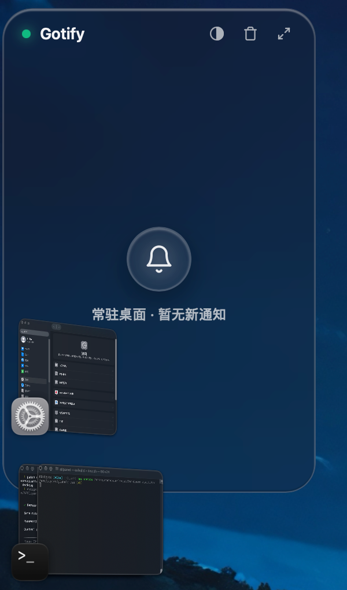
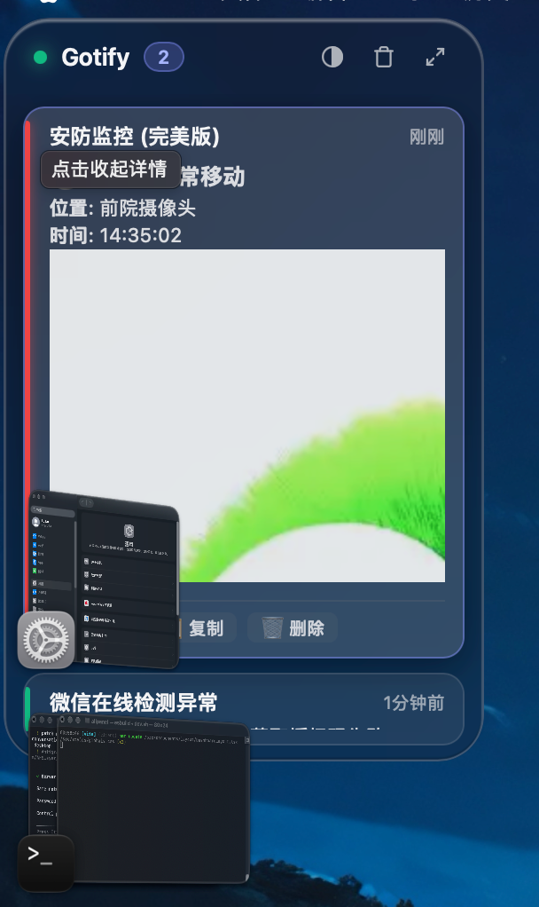

# Gotify Desktop Notifier 🔔

<p align="center">
  
</p>

<p align="center">
  <b>精雕细琢的下一代 Gotify 桌面通知客户端 · 深度融合 macOS 原生液态玻璃桌面小组件</b>
</p>

<p align="center">
  <a href="https://github.com/huahn3/gotify-desktop/releases"></a>
  <a href="https://tauri.app"></a>
  <a href="https://www.rust-lang.org"></a>
  <a href="https://github.com/huahn3/gotify-desktop/blob/main/LICENSE"></a>
  
</p>

---

## 📸 界面预览 (Screenshots)

### 🖥️ 苹果液态玻璃桌面小组件（原生沉底 · 完美兼容台前调度）
> 自由钉在桌面最底层，支持无级调节玻璃透明度；不遮挡其他软件，与 macOS 台前调度（Stage Manager）无缝协作。

<p align="center">
  
  &nbsp;
  
</p>

---

## ✨ 核心特性 (Features)

- 🪟 **沉浸式桌面小组件模式 (Desktop Widget)**
  - **原生沉底**：基于 macOS Cocoa 底层窗口优化，小组件始终安静沉在桌面，绝不遮挡 **台前调度（Stage Manager）** 的卡片与应用窗口。
  - **Apple 原生液态玻璃美学**：Squircle 连续大圆角、精细内发光浮雕、多级高斯毛玻璃效果，完美契合 macOS 现代设计规范。
  - **无级透明度调节**：内置 20%~95% 玻璃透明度调节滑块与快捷预设，随心搭配你的桌面壁纸。
  - **随心摆放**：支持自由拖拽小组件到桌面任意角落，自动记忆窗口坐标与状态。

- 🔔 **强大的 Gotify 实时通知**
  - **低延迟长连接**：基于 WebSocket 的实时消息通道，内置智能断线重连机制。
  - **系统原生通知**：支持各平台原生系统级横幅与声音提醒。
  - **富媒体与 Markdown 解析**：完美支持 Markdown 排版、图片快照直显、点击链接跳转。

- 🎨 **细节满满的桌面端体验**
  - **系统级深浅色主题自适应**：跟随系统明暗偏好秒级无缝切换。
  - **系统托盘常驻**：后台静默守护，支持开机启动与快捷呼出。
  - **安全隐私**：配置信息本地存储，支持环境变量配置与服务器 Token 隔离。

- ⚡ **极致轻量高效**
  - 基于 **Rust + Tauri 2** 构建，安装包轻巧、内存占用极低（日常运行内存 < 40MB），告别臃肿的 Electron。

---

## 🚀 下载与安装 (Installation)

### 方式一：直接下载安装包（推荐）
前往 [Releases 页面](https://github.com/huahn3/gotify-desktop/releases/latest) 下载适用于你系统的预编译安装包：
- **macOS (Apple Silicon & Intel)**：下载 `.dmg` 文件，拖入 `Applications` 即可使用。
- **Windows**：下载 `.msi` 或绿色版安装包。

### 方式二：源码构建

确保本地已安装 [Rust](https://rustup.rs/) (>= 1.77.2)：

```bash
# 1. 克隆仓库
git clone https://github.com/huahn3/gotify-desktop.git
cd gotify-desktop

# 2. 安装 Tauri CLI (若尚未安装)
cargo install tauri-cli

# 3. 运行开发模式
cargo tauri dev

# 4. 构建正式发行版
cargo tauri build
```

构建生成的安装包位于 `src-tauri/target/release/bundle/` 目录下。

---

## 🛠️ 配置说明 (Configuration)

首次打开应用后，点击右上角设置图标（或在小组件中还原主窗口）：

1. **服务器地址**：例如 `http://192.168.1.100:8080` 或 `https://gotify.example.com`
2. **客户端 Token**：在 Gotify Web 端创建 Client 并获取生成的 Token
3. **点击连接**：系统会自动测试通信并建立 WebSocket 监听通道。

也可以通过系统环境变量预先注入：
```bash
export GOTIFY_SERVER_URL="https://gotify.example.com"
export GOTIFY_CLIENT_TOKEN="your_token_here"
```

---

## 🤝 鸣谢与生态

- 核心协议：[Gotify](https://gotify.net/)
- 桌面框架：[Tauri 2](https://tauri.app/)
- 语言生态：[Rust](https://www.rust-lang.org/)

---

## 📄 开源许可证

本项目基于 [MIT License](LICENSE) 开源协议。
